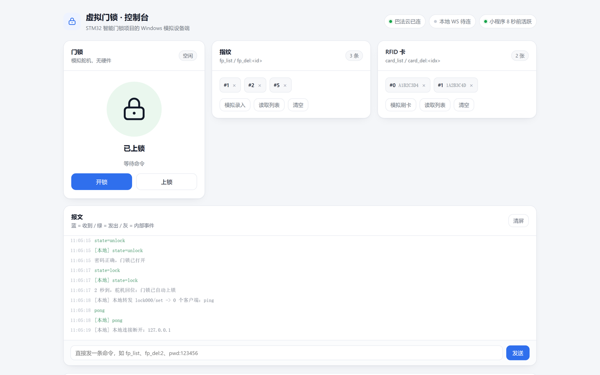
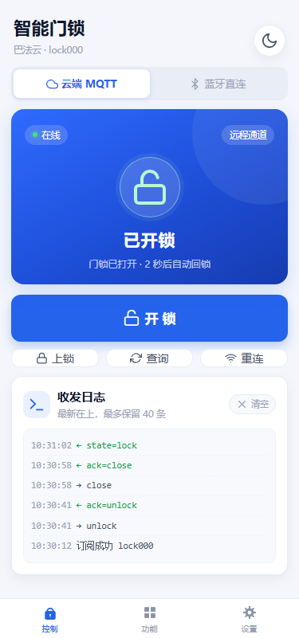
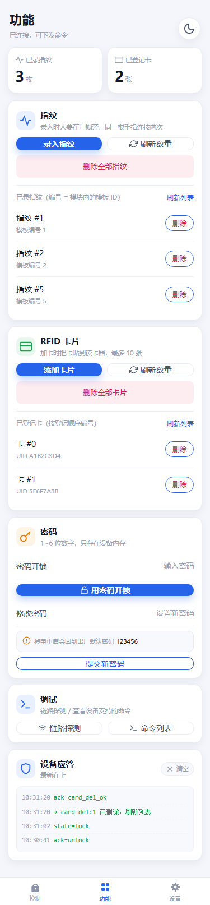
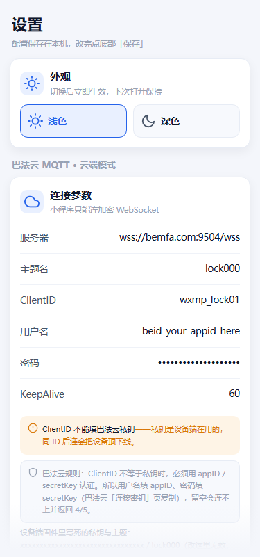

# STM32F407 Smart Fingerprint Door Lock

> An STM32F407 + AS608 fingerprint sensor + MFRC522 RFID reader door lock firmware with **five unlock methods**: fingerprint, keypad password, RFID card, WiFi and Bluetooth.
> Built on **FreeRTOS** with the ST Standard Peripheral Library (SPL), compiles and flashes from Keil MDK5.
> Ships with a **WeChat mini program** for remote unlock and remote fingerprint / card management.

[中文说明 (Chinese)](README.md)

---

## Features

| Method | Details |
| --- | --- |
| Fingerprint | AS608 over UART; enroll / match / clear the template library, match score shown on screen |
| Password | 6-digit password on a 4×4 matrix keypad, masked with `*` on the OLED, changeable at runtime |
| RFID card | MFRC522 reader, up to 10 registered cards, **auto-polling**; unknown cards trigger a buzzer alarm |
| WiFi | ESP8266 + **Bemfa cloud MQTT**; the mini program sends commands and receives live lock state |
| Bluetooth | BLE serial-transparent module; the phone connects directly from up to ~10 m, no internet needed |

- 0.96" OLED showing lock / unlock icons and Chinese status messages
- Servo auto-relocks **2 seconds** after unlocking, and the state is pushed to the phone
- Buzzer feedback plus a full 115200 bps debug log over USART1
- Mini program actions: unlock / lock / query state / enroll fingerprint / wipe fingerprints / add card / wipe cards / password unlock / change password

## Tech stack

| Item | Detail |
| --- | --- |
| MCU | STM32F407ZET6 @168 MHz, 512K Flash / 192K RAM |
| Library | ST Standard Peripheral Library v1.4.0 (**not** HAL/LL) |
| RTOS | FreeRTOS 10.x, preemptive, 1 kHz tick, heap_4, 75 KB heap |
| Toolchain | Keil MDK 5 + ARMCC (AC5), project `USER/FreeRTOS.uvprojx`, **C99 mode enabled** |
| Cloud | Bemfa MQTT 3.1.1 (`bemfa.com:9501`); MQTT packets are built on the STM32 itself, the ESP8266 only does AT pass-through |
| Mini program | Native WeChat mini program, no third-party deps; hand-written MQTT-over-WebSocket and BLE clients |

## Wiring

| Module | Bus | Pins |
| --- | --- | --- |
| AS608 fingerprint | USART2 (57600) | PA2 / PA3 |
| ESP8266 **or** BLE module | USART3 | PB10 / PB11 (mutually exclusive) |
| MFRC522 | bit-banged SPI | SCK `PD7`, MOSI `PC6`, MISO `PC8`, CS `PD6`, RST `PC11` |
| OLED SSD1306 | bit-banged I2C | SCL `PB15`, SDA `PD10` |
| SG90 servo | TIM4_CH3 PWM 50 Hz | `PD14` |
| Buzzer | GPIO | `PF8` |
| Push buttons ×3 | GPIO | KEY1 `PA0`, KEY2 `PE2`, KEY3 `PE3` |
| 4×4 keypad | GPIO scan | rows `PB7` `PA4` `PG15` `PC7`, cols `PC9` `PB6` `PE6` `PA8` |
| Debug UART | USART1 (115200) | PA9 / PA10 |

## Local controls

| Button | Short press | Double click | Long press |
| --- | --- | --- | --- |
| KEY1 | Enroll fingerprint | Add RFID card | Password unlock |
| KEY2 | Verify fingerprint | Erase all cards | Change password |
| KEY3 | Erase all fingerprints | — | — |

Keypad: `0`–`9` input, `*` backspace, `#` submit.

## Remote command set

The phone and the device exchange plain ASCII lines. Both the MQTT and the BLE link share one parser (`HARDWARE/net/remote_cmd.c`), and every remote command is converted into the same event a physical key press would produce.

**Phone → device:** `unlock`, `close`, `state`, `fp_add`, `fp_del`, `fp_num`, `card_add`, `card_del`, `card_num`, `pwd:<digits>`, `pwd_set:<digits>`, `ping`, `help`

**Device → phone:** `state=lock` / `state=unlock`, `ack=...`, `num=fp,<n>` / `num=card,<n>`, `pong`, `err=unknown`

## Architecture

One FreeRTOS task per hardware module, decoupled by event groups, queues and mutexes.

```
key task ──set bits──▶ event group ──wait──▶ feature tasks
                                            ▲
phone cmd ──▶ remote_cmd ──set bits─────────┘
                           │
                           └─ unlock ──▶ g_servo_queue ──▶ servo task (serialized)
```

Remote commands and key presses share the same event group, so a phone tap and a physical tap take exactly the same code path. Every unlock source funnels into one queue, so the servo is driven strictly one command at a time; MQTT outbound messages also go through a queue so concurrent tasks can never interleave a packet on USART3.

```
CORE/          startup file + CMSIS
FWLIB/         ST SPL (only the 8 drivers actually used are compiled)
FREERTOS/      kernel + heap_4 + ARM_CM4F port
HARDWARE/
  net/         mqtt_packet.c  pure MQTT 3.1.1 codec (no hardware deps, unit-tested on PC)
               bemfa_mqtt.c   Bemfa access: AT pass-through + non-blocking state machine + keepalive/reconnect
               remote_cmd.c   shared remote command layer
  as608/ mfrc522/ oled/ bt24-hid/ keyboard/ key/ servo/ beep/ LED/
SYSTEM/        sys (bit-band GPIO), delay, usart (with a USART3 RX ring buffer), tim
USER/          main.c, include.h, interrupts, Keil project
img/ font/     OLED bitmaps, 16×16 Chinese font table
mini-program/  WeChat mini program (control / features / settings pages)
tests/         PC-side self-checks (no Keil needed)
```

## Build

1. Open `USER/FreeRTOS.uvprojx` in Keil MDK5
2. Select target `STM32F407ZE`, compiler **ARMCC (AC5)**
3. `Rebuild` → output in `OBJ/demo.axf` / `OBJ/demo.hex`
4. Flash with J-Link / ST-Link

> **C99 mode is enabled** in this project (Options for Target → C/C++ → C99 Mode). The new network layer uses C99 in-block declarations.

> **Encoding note:** most Chinese comments in the sources are **GB2312** (Keil's default ANSI). Set your editor to `GB2312` when viewing, and keep that encoding when editing. `oled_show_string()` also relies on 2-byte GB2312 characters for its font lookup, so the sources must **not** be re-saved as UTF-8.

### PC-side self-checks

```bash
sh tests/run_tests.sh    #  or tests\run_tests.bat on Windows
```

Five stages: the firmware MQTT codec unit test (104 assertions), the mini program unit tests (byte-for-byte comparison of the packets both implementations generate), the UI static checks, a secret scan over every tracked text file (the run fails if a Bemfa AppID or secret key slips in), and a `gcc -fsyntax-only` check of the new firmware modules against stub headers. The last stage is a syntax check only — it does not replace a real Keil build.

### No board at hand? Run the virtual lock

`sim/` is a Windows virtual door lock speaking the exact same ASCII line protocol as `remote_cmd.c`
(`unlock`, `fp_list`, `fp_del:2`, …), so the mini program can be tested end-to-end without hardware.

```bat
sim\run.bat          ::  console at http://127.0.0.1:8848
sim\run-local.bat    ::  built-in broker only, nothing leaves the machine
sim\probe.bat        ::  link diagnostics: device TCP / mini program WSS / round trip
```

> **Requirements: Python 3 (3.8+) and nothing else.** The simulator is pure standard library —
> no `pip install`, no Node, no Java, no database. If Python is missing, grab it from python.org
> and tick **"Add Python to PATH"** on the first installer page. The mini program still needs
> WeChat DevTools, which is a WeChat tool and cannot be avoided.



### OTA updates (designed, not implemented yet)

The full design is in [`docs/OTA升级方案.md`](docs/OTA升级方案.md) (Chinese). In short:

- 512 KB flash split into 48K bootloader / 16K metadata / 192K run area / 128K download area / 128K backup.
  The current image is 37.8 KB, so there is plenty of headroom.
- Single image with a download slot and a backup slot, **not** A/B slots: Keil output is absolute-addressed,
  so the same binary cannot run from a second address.
- Reuses the existing Bemfa topic; binary frames start with `0x02` so text commands are unaffected.
- Resumable transfer, whole-image CRC32, and automatic rollback when a new image fails to confirm twice.
- `python tools\ota_pack.py OBJ\app.bin -v 1.3` builds the package and rejects a binary whose vector table
  still points at `0x08000000`.
- Prerequisite: persist the password and card list first, otherwise every update wipes user data.
- The first migration still needs a one-time wired flash of the bootloader over ST-Link.

See [`sim/README.md`](sim/README.md) for the protocol table and [`sim/TEST-STEPS.md`](sim/TEST-STEPS.md) for a click-by-click walkthrough.


## Configuration

- `HARDWARE/net/bemfa_mqtt.h` — WiFi SSID / password, Bemfa private key (`BAFA_UID`), topic, MQTT host/port/keepalive
- `HARDWARE/keyboard/keyboard.h` — default password
- `USER/include.h` — `USART3_WIFI_USE` / `USART3_BLE_USE` (mutually exclusive: USART3 has only one set of pins)

## Mini program

<p align="center">
  
  &nbsp;
  
  &nbsp;
  
</p>

Open the `mini-program/` folder in WeChat DevTools. During development, tick *Details → Local settings → skip domain validation*; for release, add `wss://bemfa.com` to the socket domain whitelist in the mini program console. Two modes can be switched on the home page:

- **Cloud MQTT** — `wss://bemfa.com:9504/wss`, works on any network (truly remote)
- **BLE direct** — WeChat BLE APIs, works offline within ~10 m (BLE only; classic Bluetooth SPP modules such as HC-05 are not supported)

> Never reuse the device's client ID (the Bemfa private key) for the mini program — MQTT kicks the older session when the same client ID connects twice.

## Known limitations

- Passwords and registered cards live in RAM only — they reset on power loss (add an EEPROM/Flash to persist)
- Device-to-cloud MQTT is plaintext on port 9501 (the phone-to-cloud leg uses encrypted `wss`); use 9503 + TLS for anything public
- Remote unlock is protected only by topic secrecy — anyone with the private key and topic can send `unlock`
- Disconnect detection relies on heartbeat silence: up to ~1.5 minutes before a reconnect is attempted
- Card polling is throttled to one unlock per 5 seconds
- Fingerprint library is capped at 100 templates and "delete" clears the whole library
- `fp_add` / `card_add` only make the device *wait*: the finger press or card tap must still happen at the device

## License

[MIT](LICENSE) © ymq
