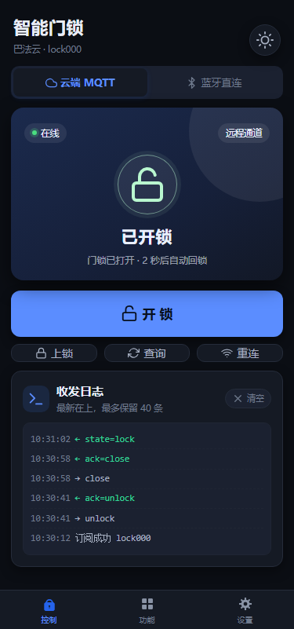
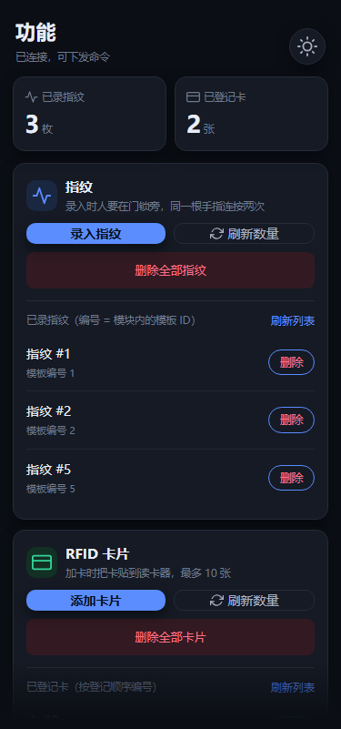
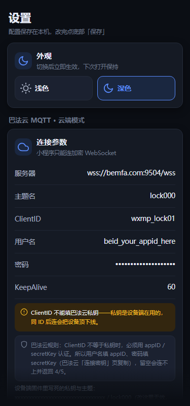

# 基于 STM32F407 的智能指纹门锁

> 一块 F407 + 一颗 AS608 指纹头 + 一张 RC522 读卡器，做出**指纹 / 密码 / 刷卡 / WiFi / 蓝牙**五种开锁方式的成品级门锁固件。
> 基于 **FreeRTOS** 多任务架构，标准库（SPL）开发，Keil MDK5 一键编译烧录。
> 配套**微信小程序**，可以远程开关门、远程录入指纹、远程添加/删除卡片。

<p align="center">
  
  &nbsp;
  
  &nbsp;
  
</p>

<p align="center"><sub>小程序 · 控制 / 功能 / 设置（浅色主题；深色主题与全部截图见「九、小程序」）</sub></p>

> 板子不在手边也能把小程序测通：仓库里带了一台 [**Windows 虚拟门锁**](sim/)，说的和固件是同一套协议，只要 Python 3、不用装别的，见下面 7.2 节。

---

## 一、功能一览

| 开锁方式 | 说明 |
| --- | --- |
| 指纹 | AS608 指纹头，UART 通信；支持录入 / 匹配 / 清空指纹库，匹配带得分显示 |
| 密码 | 4×4 矩阵键盘输入 6 位数字密码，OLED 上以 `*` 掩码回显，支持修改密码 |
| RFID 刷卡 | MFRC522 读头，最多登记 10 张卡；**自动轮询刷卡**，未授权卡蜂鸣告警 |
| WiFi 远程 | ESP8266 连**巴法云 MQTT**，小程序下发命令开锁，门锁状态实时回传 |
| 蓝牙远程 | BLE 串口透传模块，手机在门锁附近（约 10 米）直连开锁，不依赖外网 |

- 0.96" OLED 实时显示锁 / 解锁图标与全部中文提示
- 舵机开锁后 **2 秒自动回锁**，状态变化同步推给小程序
- 蜂鸣器操作提示音；串口 115200 输出完整调试日志
- 小程序操作：**一键开锁 / 上锁 / 查询状态 / 录入指纹 / 删除指纹 / 添加卡 / 删卡 / 密码开锁 / 改密码**

## 二、技术栈

| 项目 | 说明 |
| --- | --- |
| MCU | STM32F407ZET6（168 MHz，512K Flash / 192K RAM，LQFP144） |
| 库 | ST 标准外设库 SPL v1.4.0（**非** HAL/LL），`USE_STDPERIPH_DRIVER` |
| RTOS | FreeRTOS 10.x，抢占式调度，`configTICK_RATE_HZ = 1000`，heap_4，堆 75 KB |
| 工具链 | Keil MDK 5 + ARMCC（AC5），工程文件 `USER/FreeRTOS.uvprojx`，**已开启 C99** |
| 云平台 | 巴法云 MQTT 3.1.1（`bemfa.com:9501`），STM32 侧自实现 MQTT 报文，ESP8266 只用 AT 透传 |
| 小程序 | 原生微信小程序，无第三方依赖；MQTT over WebSocket 与 BLE 各一套客户端 |

## 三、硬件接线

| 模块 | 接口 | 引脚 | 备注 |
| --- | --- | --- | --- |
| AS608 指纹头 | USART2 | PA2 / PA3 | 57600 bps |
| ESP8266 / BLE 模块 | USART3 | PB10 / PB11 | **二选一**，见第 8.3 节 |
| MFRC522 读卡器 | 软件 SPI | SCK `PD7`、MOSI `PC6`、MISO `PC8`、CS `PD6`、RST `PC11` | 非硬件 SPI |
| OLED 0.96" (SSD1306) | 软件 I2C | SCL `PB15`、SDA `PD10` | 128×64 |
| SG90 舵机 | TIM4_CH3 PWM | `PD14` | 50 Hz，0.5 ms=关锁 / 1.5 ms=开锁 |
| 蜂鸣器 | GPIO | `PF8` | 高电平响 |
| 独立按键 ×3 | GPIO | KEY1 `PA0`、KEY2 `PE2`、KEY3 `PE3` | 低电平有效 |
| 4×4 矩阵键盘 | GPIO 扫描 | 行：`PB7` `PA4` `PG15` `PC7`<br>列：`PC9` `PB6` `PE6` `PA8` | 行列扫描 + 20 ms 消抖 |
| 调试串口 | USART1 | PA9 / PA10 | 115200 bps，`printf` 输出 |

> 接线定义集中在各模块头文件里（`oled.h`、`beep.h`、`key.h`、`MFRC522.h` 等），换板子只改这几个宏。

## 四、本机操作说明

### 独立按键

| 按键 | 短按 | 双击 | 长按 |
| --- | --- | --- | --- |
| KEY1 | 录入指纹 | 添加 RFID 卡 | 密码开锁 |
| KEY2 | 刷指纹 | 删除**全部** RFID 卡 | 修改密码 |
| KEY3 | 删除**全部**指纹 | — | — |

### 矩阵键盘

| 按键 | 作用 |
| --- | --- |
| `0`–`9` | 输入密码（最多 6 位，屏幕掩码显示） |
| `*` | 退格删除一位 |
| `#` | 确认提交 |
| `D` | 退出键盘测试模式 |

## 五、远程控制命令表

**手机与设备之间就是一条条 ASCII 行文本**，WiFi(MQTT) 与蓝牙(BLE) 两条链路共用同一份解析代码（`HARDWARE/net/remote_cmd.c`）。远程命令最终都转换成"等同按了某个键"的事件，走完全相同的业务路径。

### 手机 → 设备

| 命令 | 作用 |
| --- | --- |
| `unlock` | 开锁 |
| `close` | 立即上锁 |
| `state` | 查询当前门锁状态 |
| `fp_add` | 进入**录入指纹**流程（人需在门锁旁连按两次同一手指） |
| `fp_list` | 列出已录指纹的编号（逐行 `fp=<id>`，最后 `fpend=<数量>`） |
| `fp_del` | 清空设备上全部指纹 |
| `fp_del:<id>` | **删除指定编号的指纹**，如 `fp_del:3` |
| `fp_num` | 查询已录指纹数量 |
| `card_add` | 进入**添加 RFID 卡**流程（人需把卡贴上读卡器） |
| `card_list` | 列出已登记的卡（逐行 `card=<索引>,<UID>`，最后 `cardend=<数量>`） |
| `card_del` | 清空全部已登记卡 |
| `card_del:<idx>` | **删除指定索引的卡**（索引与 `card_list` 一致），如 `card_del:0` |
| `card_num` | 查询已登记卡数量 |
| `pwd:123456` | 用密码开锁（密码存在设备里，直接比对） |
| `pwd_set:654321` | 远程修改开锁密码 |
| `ping` / `help` | 链路探测 / 命令列表 |

### 设备 → 手机

| 上报 | 含义 |
| --- | --- |
| `state=lock` / `state=unlock` | 门锁已上锁 / 已开锁（状态变化时主动推） |
| `ack=unlock` `ack=close` `ack=fp_add` `ack=fp_del` `ack=card_add` `ack=card_del` | 命令已受理 |
| `ack=fp_del_ok` / `ack=fp_del_fail` / `ack=fp_del_bad` | 删除单个指纹：成功 / 该编号没有指纹 / 参数非法 |
| `ack=card_del_ok` / `ack=card_del_fail` / `ack=card_del_bad` | 删除单张卡：成功 / 索引不存在 / 参数非法 |
| `fp=<id>` … `fpend=<n>` | `fp_list` 的应答：一行一个编号，结束行给总数 |
| `card=<索引>,<8 位 UID>` … `cardend=<n>` | `card_list` 的应答 |
| `ack=pwd_ok` / `ack=pwd_fail` / `ack=pwd_set_ok` / `ack=pwd_set_bad` | 密码校验 / 改密结果 |
| `num=fp,<n>` / `num=card,<n>` | 指纹 / 卡片数量 |
| `pong` / `err=unknown` / `err=busy` / `help=<列表>` | 探测应答 / 未知命令 / 设备正忙（正在录入或刷卡） |

## 六、软件架构

FreeRTOS 多任务，**一个硬件模块一个任务**，任务间用事件标志组 / 消息队列 / 互斥量解耦：

| 任务 | 栈 | 职责 |
| --- | --- | --- |
| `task_init` | 512 | 建队列/锁/事件组，初始化全部外设，拉起其余任务后自删 |
| `task_oled` | 512 | 检测 `g_lock_state` 变化，刷新锁 / 解锁图标 |
| `task_servo` | 512 | 从 `g_servo_queue` 取指令驱动舵机，2 秒自动回锁并上报状态 |
| `task_as608` | 512 | 短按事件 → 录入 / 匹配 / 清空指纹 |
| `task_keyboard` | 512 | 长按事件 → 密码开锁 / 修改密码 |
| `task_rfid` | 512 | 双击事件 → 添加卡 / 清空卡列表 |
| `task_rfid_unlock` | 512 | 100 ms 轮询刷卡，命中已登记卡即开锁 |
| `task_key` | 512 | 10 ms 扫描 3 个独立按键，产生短按/长按/双击事件 |
| `task_esp8266` | 512 | 10 ms 推进**巴法云 MQTT 状态机**（联网 / 订阅 / 心跳 / 重连） |
| `task_ble24` | 512 | 10 ms 收蓝牙字节，按行切分后交给命令层 |

**并发模型**

```
按键任务 ──set bits──▶ 事件标志组 ──wait──▶ 各功能任务
                                              ▲
手机命令 ──▶ remote_cmd ──set bits────────────┘
                          │
                          └─ 开锁指令 ──▶ g_servo_queue ──▶ 舵机任务（串行执行）
```

- **远程命令与按键共用同一套事件标志组**，所以"手机按一下"和"手按一下"走完全相同的代码路径
- `g_mutex_function`：保证录入指纹 / 改密码 / 加卡这类需要独占人机交互的操作同一时刻只有一个
- `g_servo_queue`：所有开锁来源汇聚到一个队列，舵机动作天然串行
- MQTT 待发消息也走一个队列，由网络任务统一出队发送，避免多任务同时写 USART3 把报文交错

### 目录结构

```
CORE/          启动文件 + CMSIS 内核头
FWLIB/         ST 标准外设库（只编译用到的 8 个 .c）
FREERTOS/      FreeRTOS 内核 + heap_4 + ARM_CM4F port
HARDWARE/
  net/         ★ mqtt_packet.c  纯 MQTT 3.1.1 报文编解码（零硬件依赖，可 PC 单测）
                 bemfa_mqtt.c   巴法云接入：AT 透传 + 非阻塞联网状态机 + 心跳/重连
                 remote_cmd.c   远程命令层（WiFi 与蓝牙共用）
  as608/       AS608 指纹驱动 + 串口2 + 状态引脚
  mfrc522/     RC522 驱动 + 卡列表管理 + 刷卡解锁
  oled/        SSD1306 + 中文点阵显示
  bt24-hid/    ble.c：蓝牙透传链路（字节流 → 行）
  param/       ★ 掉电保存：密码 / 卡片写内部 Flash S3，CRC16 + 日志式追加
  keyboard/ key/ servo/ beep/ LED/
SYSTEM/        sys(GPIO 位带) / delay / usart(含 USART3 接收环形缓冲) / tim
USER/          main.c（任务定义与调度）+ include.h + 中断服务 + Keil 工程
img/           OLED 锁 / 解锁图标点阵
font/          16×16 中文字库（116 字形）与索引表
mini-program/  微信小程序（控制 / 功能 / 设置 三个页面，明暗双主题；图标在 images/，截图在 screenshots/）
sim/           ★ Windows 虚拟门锁：没有板子也能联调小程序（纯标准库 Python）
tests/         PC 端自检（不需要 Keil）
tools/         辅助脚本（gen_tabbar_icons.py 生成 tabBar 图标、render_preview.js 渲染界面截图、
               ota_pack.py 打 OTA 升级包）
docs/          设计方案（OTA升级方案.md）
```

## 七、编译与烧录

1. Keil MDK5 打开 `USER/FreeRTOS.uvprojx`
2. Target 选 `STM32F407ZE`，编译器 **ARMCC (AC5)**
3. `Rebuild` → 产物在 `OBJ/demo.axf`（含 `demo.hex`）
4. J-Link / ST-Link 下载，或直接烧 `OBJ/demo.hex`

> **这个工程打开了 C99 模式**（`Options for Target → C/C++ → 勾选 C99 Mode`）。新增的网络层用了 C99 的块内声明与 `for (size_t i = ...)`，关掉会编译不过。

> **编码注意**：源码中大量中文注释为 **GB2312 编码**（Keil 默认 ANSI）。用 VS Code 等编辑器查看时请把文件编码切到 `GB2312`，否则中文会显示为乱码。修改时也请保持原编码；另外 `oled_show_string()` 依赖 GB2312 双字节切分查中文字库，**不能**把源码另存为 UTF-8。

### 7.1 PC 端自检（不需要 Keil）

**Windows**：直接**双击** `tests\run_tests.bat`。

```
tests\run_tests.bat              :: 跑完停在「按任意键关闭窗口」，方便看结果
tests\run_tests.bat /nopause     :: 不停，CI / 脚本里用这个
```

> 双击运行时 cmd 会在脚本结束的瞬间关掉窗口（不是报错，是 cmd 的默认行为）。脚本已经内置 `pause` 停在最后一行；如果连窗口都看不到就被杀掉了，说明是**杀毒软件**拦了 bat，换个目录或加白名单再试。

脚本会自己找 `gcc`（PATH 里没有时会试 `D:\mingw64\bin`、`C:\msys64\mingw64\bin` 等常见位置）和 `node`。
需要 **MinGW-w64 gcc** + **Node.js**（第 2 步的小程序测试用）；都没有也能跑，但对应步骤会跳过/报错。

**Linux / macOS / Git Bash**：

```bash
sh tests/run_tests.sh
```

五步：

1. 固件 MQTT 报文层单测（`tests/test_mqtt.c`，104 项断言：定长/变长剩余长度、拆包、粘包、非法报文重同步、缓冲越界防护……）
2. 小程序单测：`test_mqtt_js.js` **逐字节比对**两份实现生成的 CONNECT / SUBSCRIBE / PUBLISH 报文；`test_ble.js` 用假 `wx` 验证蓝牙扫描（设备合并、排序、过滤标记、兜底轮询、自检）；`test_features.js` 用假 `Page/getApp/wx` 跑功能页逻辑（列表拼装、单项删除命令、删除后自动刷新、`err=busy`）
3. 小程序界面静态检查（`tests/test_ui.js`，159 项：wxml 标签配对、`bindtap` 的方法是否存在、用到的 `i-*` 图标类是否定义、深浅两套主题的 CSS 变量是否齐全、`app.json` 里页面与 tabBar 图标文件是否都在）
4. 敏感信息扫描（`tests/check_secrets.js`：扫所有 git 已跟踪的文本文件，出现巴法云 AppID / SecretKey 形态的字符串就红，防止密钥被写进代码或截图脚本）
5. 固件新增模块语法自检（`gcc -fsyntax-only` + `tests/stub/` 里的假头文件，抓拼写和原型不匹配）

全绿时最后会打印：

```
----------------------------------------------
 全部通过（5/5）。
----------------------------------------------
```

有失败会停在对应步骤并打印 `自检失败`，退出码为 `1`。
> 第 3 步只是语法检查，**不能替代在 Keil 里真正编译一次**。

### 7.2 没有板子？跑一台虚拟门锁

板子不在手边时，用 `sim/` 里这台 **Windows 虚拟门锁**代替真机。它跑在 PC 上，说的是和
`HARDWARE/net/remote_cmd.c` **一模一样**的 ASCII 行协议（`unlock` / `fp_list` / `fp_del:2` …），
所以小程序不用改一行代码就能连它、开关它、删它的指纹和卡。

```
小程序 ──MQTT/WebSocket──► 巴法云 ──MQTT/TCP──► sim/（虚拟门锁）
   └───────────── 或者 ─────────────► ws://127.0.0.1:9001（本地模式，完全不出网）
```

双击 **`sim\run.bat`**，控制台自动开在 <http://127.0.0.1:8848>：

> **运行前提：只要 Python 3**（3.8+）。模拟器全部用标准库，不用 `pip install` 任何东西，
> 也不需要 Node / Java / 数据库。没装 Python 的话去 python.org 下载，安装第一页勾上
> **"Add Python to PATH"**。小程序那一侧仍需微信开发者工具（微信官方工具，绕不开）。


左边是虚拟门锁（开锁 / 上锁），中间是它的指纹库和卡库，下面**报文区**把每一条收发都记下来
（蓝 = 收到、绿 = 发出、灰 = 内部事件），底部还能直接手打一条命令。页面上点按钮和从小程序发命令
走的是**同一个** `handle(line)` 入口，所以"控制台能跑通"基本等价于"小程序能跑通"。

| 文件 | 作用 |
| --- | --- |
| `sim\run.bat` | 云端 + 本地两条链路一起开（默认） |
| `sim\run-local.bat` | 只跑内置 broker，一个字节都不出网，适合改完代码立刻测 |
| `sim\run-mine.bat` | 交互输入你自己的主题名和私钥 |
| `sim\probe.bat` | 链路诊断：设备侧 TCP / 小程序侧 WSS / 双向路由，分三段报结果 |

小程序那边怎么填、每一步该看到什么，见 [`sim/TEST-STEPS.md`](sim/TEST-STEPS.md)；
模拟器自己的说明和协议对照见 [`sim/README.md`](sim/README.md)。自测：

```bat
cd sim
python tests\test_protocol.py     :: 32 条用例，全部对齐 remote_cmd.c
```

> 模拟器和真机的差别只有三处：录指纹/加卡是 2 秒后自动塞一条（真机要按手指、贴卡）、
> 不会掉电重启、容量按 100 枚指纹 / 10 张卡。都写在 `sim/README.md` 里。

### 7.3 远程升级（OTA）

方案已经论证完整，**固件代码还没实现**，只做好了打包工具。全部细节见
[`docs/OTA升级方案.md`](docs/OTA升级方案.md)。要点：

- 512 KB Flash 切成 32K Bootloader / 16K OTA 元数据 / 16K 用户参数 /
  192K 运行区 / 128K 下载区 / 128K 备份区，当前固件只有 37.8 KB，余量足够
- 用「单镜像 + 下载区 + 备份区」，不用 A/B 双槽——Keil 的固件是绝对地址，
  同一份 bin 放到另一个地址跑必然飞掉
- 复用现有巴法云主题，二进制帧首字节 `0x02` 与文本命令区分，不用新开主题、不用第二把私钥
- 断点续传、整包 CRC32、启动两次未确认自动回滚
- 打包：`python tools\ota_pack.py OBJ\app.bin -v 1.3`（会检查链接地址和 128 KB 上限）
- 密码与卡片的掉电保存已先做好（见 8.4），升级重启不会丢用户数据
- **第一次仍然必须用 ST-Link 有线烧一次 Bootloader**，OTA 只能免掉"以后"


## 八、配置

### 8.1 巴法云 / WiFi —— `HARDWARE/net/bemfa_mqtt.h`

```c
#define WIFI_NAME       "ymq"           // ← 改成自己的 WiFi SSID（ESP8266 只支持 2.4G）
#define WIFI_PASSWORD   "88888888"      // ← 改成自己的 WiFi 密码
#define BAFA_UID        "28ecc..."      // ← 巴法云 MQTT 控制台里的「私钥」，用作 ClientID
#define BAFA_TOPIC_LOCK "lock000"       // ← 主题名，与小程序里填的保持一致
#define BAFA_HOST       "bemfa.com"
#define BAFA_PORT       9501            // MQTT 明文端口
#define MQTT_KEEPALIVE_S 60
```

### 8.2 密码 —— `HARDWARE/keyboard/keyboard.h`

```c
#define PASSWORD_MAX_LEN 6          // 密码位数
#define DEFAULT_PASSWORD "123456"   // 出厂默认密码；修改后会写进内部 Flash，掉电保留
```

### 8.3 WiFi / 蓝牙二选一 —— `USER/include.h`

```c
#define USART3_WIFI_USE 1   // 1 = USART3 接 ESP8266，跑巴法云 MQTT
#define USART3_BLE_USE  0   // 1 = USART3 接 BLE 模块，跑蓝牙透传
#define WIFI_BAUD       115200
#define BLE_BAUD        9600
```

> **硬件限制**：USART3 只有一组引脚（PB10/PB11），同一时刻只能接一个模块。所以"云端 + 蓝牙"对应**两份固件配置**，不能在同一块板子上同时用。小程序里两条通道都做了，用哪个取决于板子上插的是哪个模块。

### 8.4 掉电保存 —— `HARDWARE/param/`

**指纹不需要存**：AS608 的模板存在模块自己的 Flash 里，STM32 只是用 `PS_ValidTempleteNum`
每次现查数量，断电不丢。真正掉电丢的只有密码和卡片列表，现在这两样都写进了内部 Flash。

| 项目 | 位置 | 说明 |
|---|---|---|
| 存储介质 | 内部 Flash **S3 扇区**，`0x0800C000`，16 KB | F407 没有片内 EEPROM，板上也没有外挂 24Cxx / W25Qxx |
| 记录方式 | 每条 64 字节，**追加写** | 改一次只写一条，不擦整扇区；256 条写满才压缩一次 |
| 校验 | CRC16-CCITT + magic + 递增序号 | 断电写坏的记录会被跳过，自动退回上一条完好记录 |
| 代码上限 | IROM1 已改为 `0x08000000 / 0xC000`（48 KB） | 防止代码长到 S3 把这个扇区盖掉 |

```c
param_init();            // task_init() 里调用，上电恢复密码与卡片
param_save_password();   // 改密码后调用（本地键盘 / 小程序 pwd_set 都已接上）
param_save_cards();      // 加卡 / 删卡后调用（加卡、删一张、删全部都已接上）
```

实测（PC 单测，不需要板子）：`tests/test_param.c` 8 组用例，覆盖空白 Flash、密码/卡片持久化、
删卡后顺序、记录损坏回退、256 条写满压缩、两类记录互不覆盖、空密码拒绝。

```bat
tests\run_tests.bat        :: 第 6 步就是它
```

> 顺带修了一个漏洞：原来改密码时连按 `#` 提交空密码也能成功，重启后依旧生效，
> 等于按 `#` 就能开门。现在输入 0 位会提示"密码不能为空"，`param_save_password()`
> 也拒绝写入空密码，双保险。

> 寿命：每次改密码/加删卡写一条 64 字节，256 次后才擦一次扇区。按每天改 10 次算，
> 一个扇区能撑 20 年以上（F407 扇区擦写寿命 1 万次）。

## 九、小程序

目录 `mini-program/`，原生小程序，无任何 npm 依赖。

### 导入

1. 微信开发者工具 → 导入项目 → 目录选仓库里的 `mini-program/`
2. AppID 填你自己的（或点「测试号」）；`project.config.json` 里默认写的是 `touristappid`
3. 开发阶段勾选 **详情 → 本地设置 → 不校验合法域名、web-view、TLS 版本以及 HTTPS 证书**
   （正式发布要在小程序后台把 `wss://bemfa.com` 加进 **socket 合法域名**）

### 界面：明暗双主题

三个页面共用一套设计语言，配色全部走 CSS 变量，写在 `app.wxss` 的 `.theme-light` / `.theme-dark` 两个块里。

- **切换方式**：控制页 / 功能页右上角的月亮·太阳按钮，或设置页「外观」里选浅色 / 深色
- 主题存在本地，下次打开保持；切换时**导航栏、页面底色、tabBar 一起变**
- 要换配色只改那两个变量块，页面样式不用碰

| 控制 · 浅色 | 控制 · 深色 | 功能 · 浅色 | 功能 · 深色 |
|:--:|:--:|:--:|:--:|
|  |  |  |  |

| 设置 · 浅色 | 设置 · 深色 |
|:--:|:--:|
|  |  |

图标分两套：

| 位置 | 实现 | 说明 |
| --- | --- | --- |
| 页面内 | `app.wxss` 里的 `.i-*` 类（SVG data URI + `mask`） | 颜色取 `currentColor`，放在按钮里自动变白、放在标签里自动变主题色 |
| tabBar | `images/tabbar/*.png` | 微信只认 png/jpg，图标由 `tools/gen_tabbar_icons.py` 用标准库按像素画出来（不需要装 Pillow） |

> 改完界面建议跑一次 `tests\run_tests.bat`：第 3 步会检查 wxml 标签配对、`bindtap` 绑定的方法是否存在、图标类是否漏定义、主题变量是否两边都写全 —— 这些都是「一打开就白屏 / 点了没反应 / 图标不显示」的常见原因。

### 两种控制模式

| 模式 | 走什么 | 前提 | 适用 |
| --- | --- | --- | --- |
| 云端 MQTT | `wss://bemfa.com:9504/wss` | 设备端用 ESP8266 且已连上 WiFi | 手机在任何网络都能开锁，**真·远程** |
| 蓝牙直连 | 微信 BLE API | 设备端用 BLE 透传模块 | 手机在门锁约 10 米内，断网也能用 |

首页顶部一键切换。

### 关键配置（设置页）

| 项 | 填什么 |
| --- | --- |
| 服务器 | `wss://bemfa.com:9504/wss`（小程序只能连加密 WebSocket，巴法云对应端口 9504、路径 `/wss`） |
| 主题名 | 与固件 `BAFA_TOPIC_LOCK` 一致，例如 `lock000` |
| ClientID | **必须是设备之外的另一个 ID**，默认 `wxmp_lock01` |
| 用户名 / 密码 | **必填**：填巴法云「连接密钥」页的 `appID` / `secretKey`。因为 ClientID 不是私钥，巴法云走的是账号密码认证，留空会返回 4/5 |
| Service / 特征值 UUID | 留空 = 自动识别（遍历服务挑第一个可写特征值）；识别不到时先连上设备，点「列出已连接设备的全部 UUID」，点一行自动填入 |

> ⚠️ **ClientID 千万不要和设备端用同一个**。设备端用的是巴法云「私钥」，而 MQTT 规定同一 ClientID 后连的会把先连的顶下线 —— 两个都填私钥会让设备反复掉线。

### 怎么用（云端模式）

1. **设备端先就位**：板子插 ESP8266，`HARDWARE/net/bemfa_mqtt.h` 里填 WiFi 和主题名，烧录后上电。串口看到连上 WiFi + MQTT 才算准备好。
2. 巴法云控制台建一个同名主题（如 `lock000`），类型选插座/开关都行。
3. 小程序打开 → **设置页**确认主题名与固件一致 → 保存。
4. 回 **控制页**，顶部选「云端 MQTT」，脚本会自动连；圆点变绿 = 已连上。
5. 点 **开锁**，舵机转 90° 并在 **2 秒后自动回锁**，状态会实时回显在这张卡片上。
6. 想确认设备在线就点 **查询状态**，没响应一般是钥匙/主题填错或设备掉线。

### 功能页命令表

功能页的按钮等价于远程按了设备上的某个键，**指纹录入 / 加卡这类操作需要人站在门锁旁边配合**（要按手指、贴卡），远程只能查列表、查数量和删除。

| 按钮 | 下发 | 说明 |
| --- | --- | --- |
| 录入指纹 | `fp_add` | 设备进入录入流程，随后在门锁上连按两次同一手指 |
| 刷新列表（指纹） | `fp_list` | 设备逐个编号探测，回 `fp=<id>` 若干行 + `fpend=<N>` |
| 某一项「删除」 | `fp_del:<id>` | 弹确认框后下发，成功回 `ack=fp_del_ok` 并自动刷新列表 |
| 删除全部指纹 | `fp_del` | 不可撤销 |
| 指纹数量 | `fp_num` | 回 `num=fp,N` |
| 添加卡片 | `card_add` | 随后把卡贴到读卡器 |
| 刷新列表（卡片） | `card_list` | 回 `card=<索引>,<UID>` 若干行 + `cardend=<N>` |
| 某一项「删除」 | `card_del:<idx>` | 索引就是列表里显示的编号；成功后自动刷新 |
| 删除全部卡 | `card_del` | 不可撤销 |
| 卡片数量 | `card_num` | 回 `num=card,N` |
| 密码开锁 | `pwd:xxxxxx` | 1~6 位数字 |
| 修改密码 | `pwd_set:xxxxxx` | **只存内存，掉电回到 `123456`** |
| ping / help | `ping` / `help` | 链路探测 / 设备返回命令列表 |

### 单独删除某个指纹 / 某张卡

功能页里每张卡片下半部分就是列表：

- **指纹**：显示 `指纹 #0`、`指纹 #1`……，编号就是 AS608 里的模板编号（也是刷指纹时模块返回的 `pageID`）。
  点某一项的「删除」→ 确认 → 设备执行 `PS_DeletChar(id, 1)`，只删这一条。
- **卡片**：显示 `卡 #0 · UID AABBCCDD`，编号是设备内存里的登记顺序。删除后后面的卡会**依次前移**，
  编号重新连续，不会跳号。

两点必须知道：

1. **AS608 只能存模板，不存名字**，所以列表只能给出编号，没有"左手食指"这类标签。想区分只能靠录入顺序，或者用指纹试一次看日志里的 `ID`。
2. **`fp_list` 是逐个编号探测出来的**（AS608 没有"列出全部模板"的命令），
   每次探测要发一条 `PS_LoadChar`，所以指纹较多时（接近满库 100）可能要等 1~2 秒；
   设备正忙（正在录指纹/刷卡）时会直接回 `err=busy`，小程序会提示稍后再试。

### 怎么用（蓝牙模式）

1. 板子改插 BLE 透传模块（USART3 同一组引脚，不能和 ESP8266 同时插），烧对应配置的固件
2. 控制页顶部切到「蓝牙直连」→ 点 **扫描设备** → 列表里点「连接」
3. 连上后页面会显示识别到的服务/特征值；第一次连过的设备会被记住，下次切过来自动重连
4. 之后的按钮操作和云端模式完全一样（同一套命令文本）

### 关于 BLE 模块

微信小程序只支持 **BLE 低功耗蓝牙**，连不上 HC-05 / HC-06 这类**经典蓝牙 SPP** 模块。请用 BLE 串口透传模块（JDY-24M、HM-10、AT-09 之类，常见服务 `0000FFE0`、特征值 `0000FFE1`）。

**ESP8266 没有蓝牙**（它只有 WiFi），所以「蓝牙直连」不是连 ESP8266，而是 USART3 上另插的那颗 BLE 模块。想要 WiFi + 蓝牙一颗芯片搞定，只能换 ESP32。

扫描列表**列出附近全部 BLE 设备**（不按名字隐藏，命中过滤词的会标「匹配」）。扫不到时按顺序排查：

| 现象 | 原因与处理 |
|---|---|
| 列表一直是空，日志里连"开始扫描"都没出现 | 在**微信开发者工具模拟器**里扫不到真实蓝牙，必须用**真机预览 / 真机调试** |
| 提示「系统蓝牙未开启」 | 手机蓝牙没开；**安卓还要同时打开系统定位开关**，BLE 扫描依赖它 |
| 提示「蓝牙初始化失败」`10001` | 同上，蓝牙或定位没开 |
| 有设备但全是「(无名设备)」，找不到自己的模块 | 模块没在广播名称，或已被别的手机连上（BLE 模块通常只允许一个中心设备） |
| 列表里完全没有自己的模块 | 模块是经典蓝牙（HC-05/06、JDY-31），或没供电 / 波特率与 `BLE_BAUD` 不匹配 |
| 连接报 `10003` / `10012` | 设备被其他手机占用，或距离太远；给模块断电重启再试 |

控制页设备卡底部有 **「扫描不到设备？点这里做一次蓝牙自检」**，会把适配器状态、系统蓝牙开关、定位开关、小程序授权、已发现数量打到日志里；设置页也有同样的按钮，结果直接列出来。先看这个再查硬件。

## 十、已知取舍

- **密码与卡号不持久化**：改过的密码、登记的卡都存在 RAM，掉电复位后回到默认值（需加 24C02/Flash 才能掉电保存）
- **设备到云端是明文 MQTT**：STM32 侧走 `bemfa.com:9501` 明文端口（小程序到云端那段是加密的 wss）。上公网请改用 9503 + TLS，本工程未实现
- **远程开锁只靠主题隔离**：知道私钥和主题名的人都能发 `unlock`，没有额外口令校验，适合个人 / 内网使用
- **MQTT 断线判定靠静默超时**：正常在线每 30 s 一次心跳应答，连续 90 s 收不到任何字节才判掉线重连，所以从掉线到重连最多约 1.5 分钟
- **刷卡轮询为 5 秒节流**：`check_card_unlock()` 命中后 5 秒内不再重复触发，防止一张卡连开多次
- **指纹库容量按 100 枚**：`AS608Para.PS_max = 100`，指纹 ID 直接取当前有效模板数，"删除"是清空整库而非按 ID 删
- **`fp_add` / `card_add` 只是"进入流程"**：远程只能让设备开始等待，按手指、刷卡这两步必须有人在设备旁边完成

## 十一、开源协议

[MIT](LICENSE) © ymq
