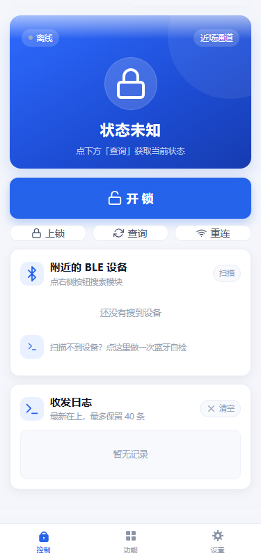
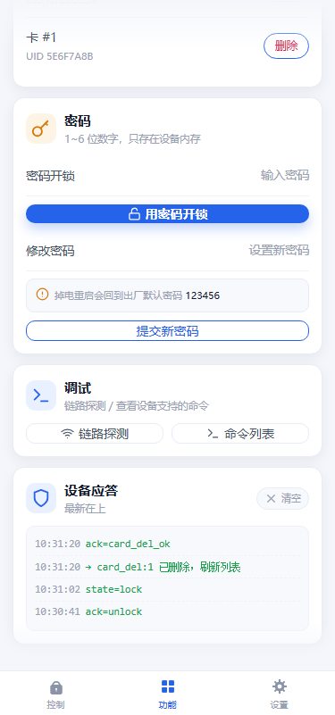
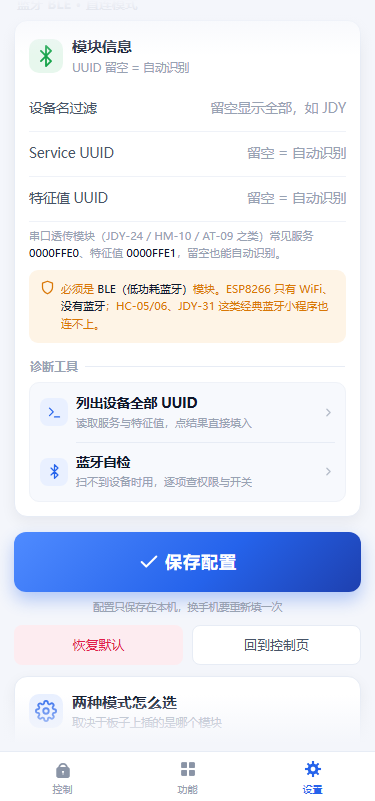

# 微信小程序端

原生小程序，**没有任何 npm 依赖**，用微信开发者工具直接导入这个目录即可。
固件端的说明在仓库根目录 [README.md](../README.md)。

## 三个页面

| 页面 | 路径 | 干什么 |
| --- | --- | --- |
| 控制 | `pages/index/` | 一键开锁 / 上锁 / 查询状态 / 重连，收发日志，BLE 设备列表与扫描自检 |
| 功能 | `pages/features/` | 录入与删除指纹、添加与删除卡片、密码开锁、改密码、链路探测 |
| 设置 | `pages/settings/` | 巴法云连接参数、BLE 的 UUID、外观（浅色 / 深色）、诊断工具 |

控制页顶部可切换两条通道：

- **云端 MQTT** — `wss://bemfa.com:9504/wss`，手机在任何网络都能开锁
- **蓝牙直连** — 微信 BLE API，手机在门锁 10 米内，断网也能用

## 目录

```
app.js / app.json / app.wxss   入口与全局样式（明暗两套主题变量都在 app.wxss）
pages/                         三个页面，每个页面 wxml / wxss / js / json
utils/
  mqtt.js      MQTT 3.1.1 over WebSocket 客户端（自己实现报文，与固件逐字节对齐）
  ble.js       BLE 扫描 / 连接 / 收发
  channel.js   两条通道的统一入口：switchMode / send / 状态回调
  store.js     本机配置（wx.setStorageSync）
  theme.js     主题切换 + 导航栏 / tabBar 同步
images/tabbar/                 tabBar 图标（png，由 ../tools/gen_tabbar_icons.py 生成）
screenshots/                   各页面截图（下面）
```

## 截图

**首屏**（浅 / 深各一份）

| 控制 · 浅色 | 控制 · 深色 | 功能 · 浅色 | 功能 · 深色 |
|:--:|:--:|:--:|:--:|
|  |  |  |  |

| 设置 · 浅色 | 设置 · 深色 |
|:--:|:--:|
|  |  |

**下半部分**（只有浅色，展示蓝牙直连 / 密码调试 / 模块信息）

| 控制 · 蓝牙直连 | 功能 · 密码 / 调试 | 设置 · 模块信息 / 诊断 |
|:--:|:--:|:--:|
|  |  |  |

这些图是 `../tools/render_preview.js` 读真实的 `app.wxss` + 页面 `wxml/wxss`、
按 375 宽手机屏渲染后截下来的，全部 375×801。改了界面重跑：

```bash
# 六个首屏（浅 + 深），在仓库根目录执行
node tools/render_preview.js --png --height 801

# 三张下半部分
node tools/render_preview.js --png --theme light --page index --state ble --height 801 --slice 115
node tools/render_preview.js --png --theme light --page features --tag lower --height 801 --slice 813
node tools/render_preview.js --png --theme light --page settings --tag lower --height 801 --anchor 模块信息
```

参数含义：

| 参数 | 作用 |
| --- | --- |
| `--height 801` | 统一截成 375×801，并排不会一高一矮；超出部分底部渐隐 |
| `--slice N` | 从第 N 像素开始截（配合 `--height` 取下半段），上下都渐隐 |
| `--anchor 文字` | 自动定位到含该文字的卡片，省得手算坐标 |
| `--state ble` | 控制页换成「蓝牙直连、没扫到设备」的状态（只改数据不改模板） |
| `--tag lower` | 输出文件名加后缀，避免覆盖首屏那批 |

去掉 `--height` 截的是整页长图（控制页 801 / 功能页 1614 / 设置页 1825）。

## 自测

界面改完跑一次仓库根目录的 `tests\run_tests.bat`，第 3 步会检查
wxml 标签是否配对、`bindtap` 绑定的方法是否存在、`i-*` 图标类是否漏定义、
深浅两套主题变量是否写全 —— 这些都是"一打开就白屏 / 点了没反应"的常见原因。
